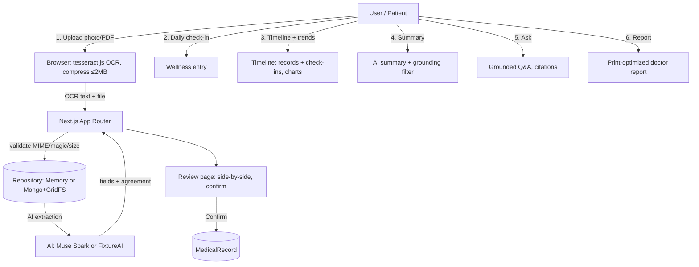

# MediSathi — মেডিসাথী

> Repo: https://github.com/ariandesu/MedBuddy
> Live: https://medbuddy-tau.vercel.app (demo data mode + live Muse AI)

Plain-language health record helper for low health literacy (Bangla/English).
Digitize prescriptions + lab reports, review extracted values, get simple explanations,
log daily check-ins, see timeline + trends, generate source-linked summaries, ask grounded
questions, print a doctor-ready report.

## One-paragraph pitch

MediSathi helps people with low health literacy digitize old prescriptions and lab reports
(photos/PDFs, with on-device OCR in Bangla + English), review and correct the extracted values,
get plain-language explanations from Muse Spark, log a daily wellness check-in, view a timeline
with trend charts, generate a dated, source-linked health summary, ask questions grounded in
their own records, and print a doctor-ready report. It is explicitly **not** a diagnostic tool.

## Demo

- Repo: https://github.com/ariandesu/MedBuddy
- Demo login: `demo@medisathi.app` / `demo1234`
- Default language: Bangla (`bn`), switchable in the header (cookie `medisathi-locale`)

## Screenshots

*(Add screenshots of dashboard, documents, review, timeline, and report here.)*

## Stack

- Next.js 16 App Router, TypeScript (strict), Tailwind CSS v4
- shadcn/ui only (base-nova) + lucide-react + sonner + recharts
- pnpm; deploy target: Vercel
- Auth.js v4 (credentials + JWT, bcryptjs); MongoDB (GridFS) or in-memory demo store
- OpenAI SDK → Muse Spark (Meta Model API) or canned FixtureAI in demo mode

## Runtime modes

| `MONGODB_URI` | `MODEL_API_KEY` | Data layer | AI layer |
|---------------|-----------------|------------|----------|
| absent | absent | MemoryRepository (seeded fixtures) | FixtureAI (sample) |
| set | absent | MongoRepository | FixtureAI |
| absent | set | MemoryRepository | MuseAI |
| set | set | MongoRepository | MuseAI |

Demo mode builds with **only `AUTH_SECRET`** — no Mongo or Muse credentials required.

## Environment variables

Create `.env.local` (git-ignored, never commit):

```
AUTH_SECRET=            # REQUIRED. Generate: openssl rand -base64 32
MONGODB_URI=            # optional; absent => demo mode
MONGODB_DB=medisathi
MODEL_API_KEY=          # optional; absent => fixture AI
MUSE_MODEL=muse-spark-1.3
MUSE_BASE_URL=https://api.meta.ai/v1
```

`.env.example` contains the empty-key template.

## Local setup

```bash
# 1. Install deps
pnpm install

# 2. Copy env template (real secrets go in .env.local, never committed)
cp .env.example .env.local
# edit .env.local with your values (AUTH_SECRET required)

# 3. Dev server
pnpm dev

# 4. Verify checks
pnpm lint && pnpm typecheck && pnpm test && pnpm build

# 5. Build must also pass with only AUTH_SECRET (demo mode):
mv .env.local /tmp/ && pnpm build && mv /tmp/.env.local .env.local
```

## Architecture



## Privacy statement (honest)

- HTTPS in transit (Vercel); MongoDB Atlas at-rest encryption.
- OCR runs **in your browser** (tesseract.js); document bytes never leave your device for OCR.
- Documents **ARE sent to the Meta Model API (Muse Spark)** for interpretation — not end-to-end encrypted.
- Demo mode uses synthetic data only (`isSample`); resets on reload.
- Not end-to-end encrypted. Do not upload real sensitive documents if you require E2EE.

## Medical disclaimer

MediSathi explains your records in simple language. It is **not a diagnostic tool** and **never replaces a doctor**.
It never prescribes, never changes doses, never says "you don't need a doctor."
If you have severe symptoms (chest pain, difficulty breathing, fainting, severe bleeding, confusion, stroke signs),
call **999** (Bangladesh) or go to the nearest hospital immediately.

## Deploy (Vercel)

1. Connect the GitHub repo to Vercel.
2. Add env vars in Vercel project settings: `AUTH_SECRET`, `MONGODB_URI`, `MONGODB_DB`, `MODEL_API_KEY`, `MUSE_MODEL`, `MUSE_BASE_URL`.
3. Atlas: add Vercel IP (or 0.0.0.0/0) to Network Access list.
4. Run once: `pnpm tsx scripts/init-indexes.ts` (creates Mongo indexes idempotently).
5. Deploy. The app works in demo mode until env vars are set in Vercel.

## Switching to MongoDB

Set `MONGODB_URI` (and `MONGODB_DB`) in `.env.local` / Vercel. The app auto-creates indexes on first
connection and via `scripts/init-indexes.ts`. Contract tests run against both `MemoryRepository` and
`MongoRepository` (mongodb-memory-server).

## Checks (must pass before push)

```
pnpm lint && pnpm typecheck && pnpm test && pnpm build
```

Build verified with empty env and with only `AUTH_SECRET`.

## Docs

- `AGENTS.md` — build spec (milestones M1–M9)
- `docs/ARCHITECTURE.md` — this architecture
- `docs/THREAT_MODEL.md` — threats & mitigations
- `docs/DECISIONS.md` — decision log
